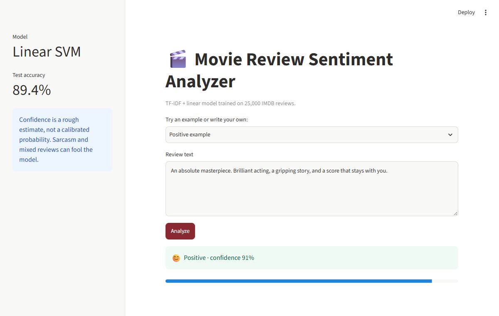
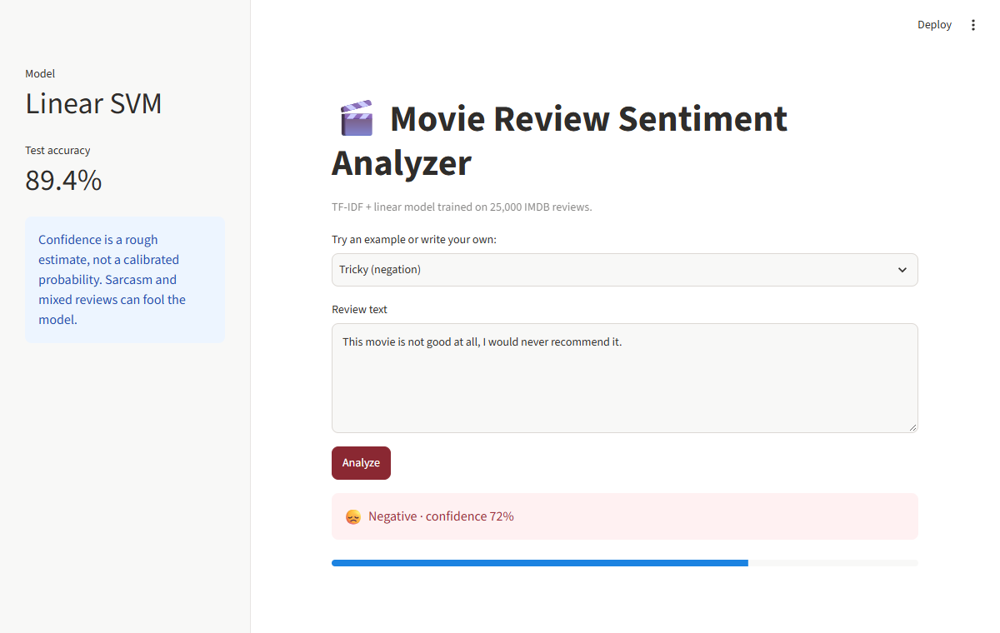
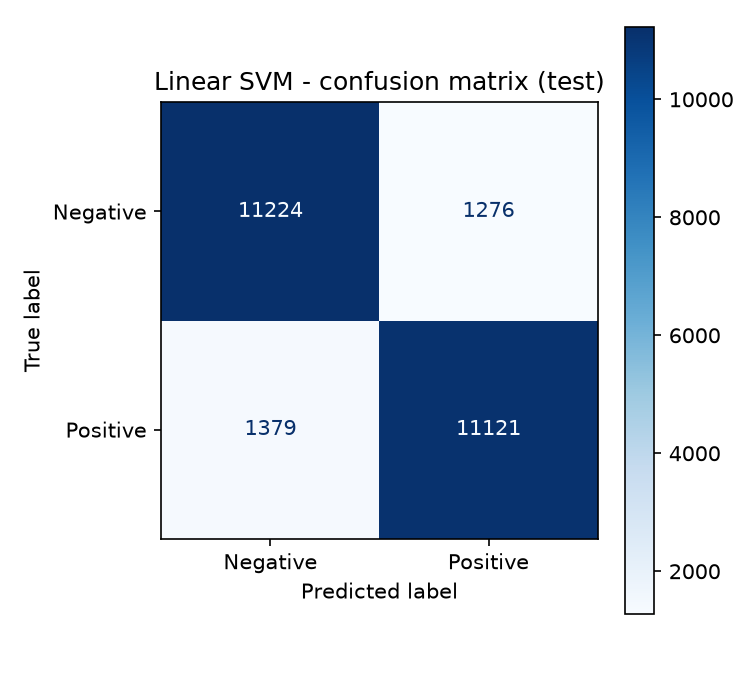
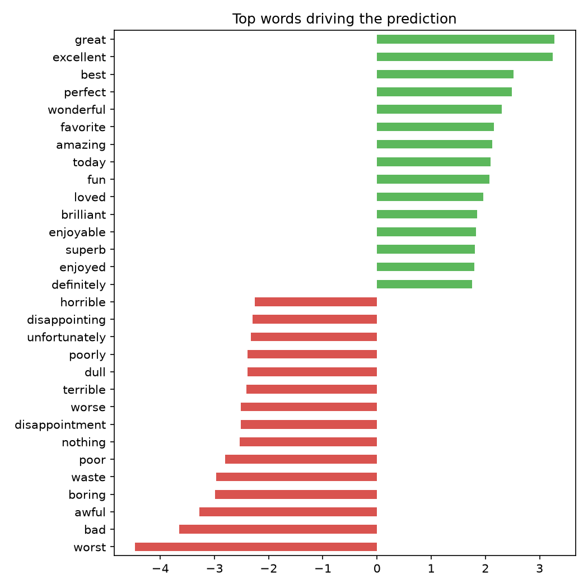
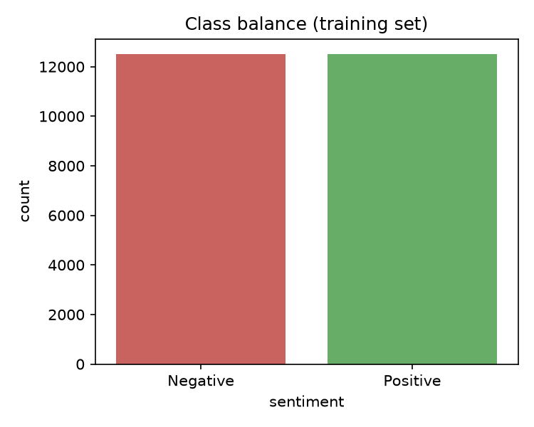
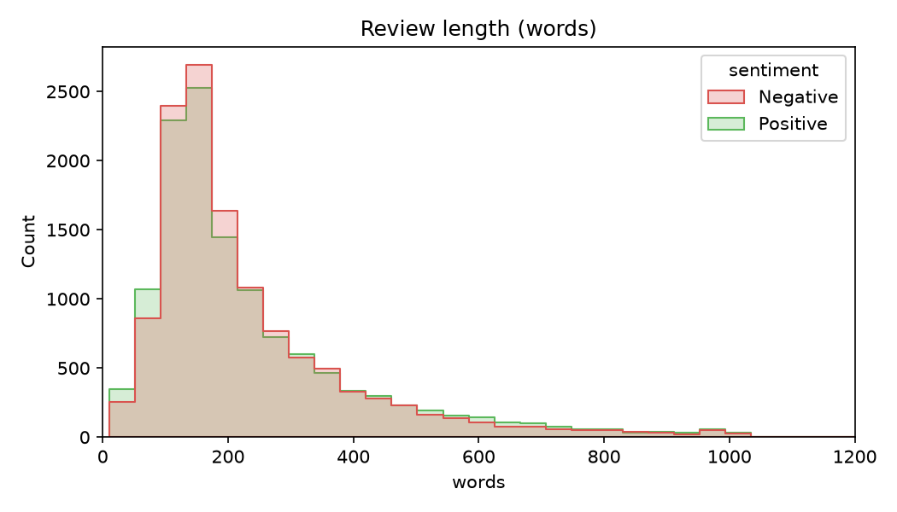
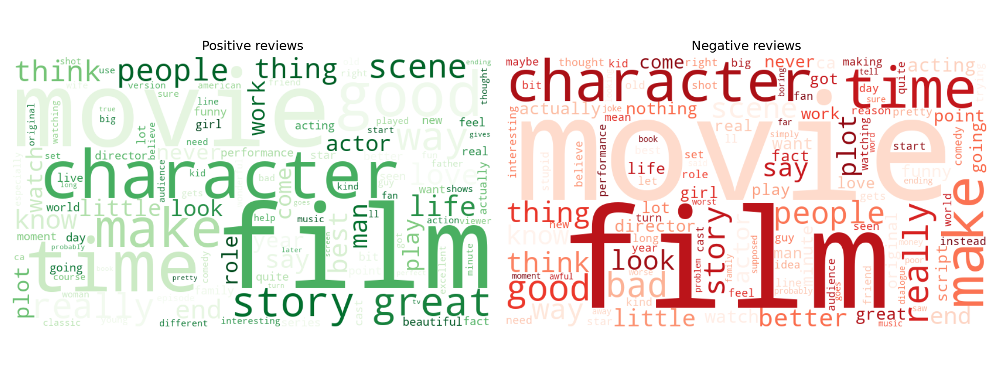

# 🎬 Movie Review Sentiment Analysis


Classifies IMDB movie reviews as **positive** or **negative** using TF-IDF features and classical machine
learning models, with a **Streamlit web app** for live predictions.

---

## 📸 Demo

Type any review and get an instant prediction with a confidence score. The model handles negation correctly
("not good" is negative) because negation words are kept during preprocessing.

| Positive review | Negation handled correctly |
|:---:|:---:|
|  |  |

---

## 📊 Results (official IMDB 25k test set)

| Model | Val Accuracy | Test Accuracy | Precision | Recall | F1 |
|---|---|---|---|---|---|
| Naive Bayes | 0.8804 | 0.8609 | 0.8828 | 0.8323 | 0.8568 |
| Logistic Regression | 0.8976 | 0.8930 | 0.8962 | 0.8890 | 0.8926 |
| **Linear SVM** (selected) | **0.8996** | **0.8933** | 0.8959 | 0.8900 | 0.8930 |

The best model is chosen on a **validation split** (10% of train), not on the test set, so the test score is an
honest estimate. The shipped model is then refit on all 25k training reviews (final test accuracy: **89.4%**).

### Confusion matrix and what the model learned

On the 25,000 test reviews, the final model got 11,224 negative and 11,121 positive reviews right, with
1,276 false positives and 1,379 false negatives. Errors are balanced between the two classes.

| Confusion matrix | Top words driving predictions |
|:---:|:---:|
|  |  |

The word weights (right) come straight from the linear model. Words like *excellent*, *great* and *perfect*
push toward positive, while *worst*, *bad* and *awful* push toward negative.

---

## 🔍 Exploratory Data Analysis

The dataset is perfectly balanced (12,500 positive and 12,500 negative training reviews). Reviews average about
234 words, with a long tail of very long reviews.

| Class balance | Review length |
|:---:|:---:|
|  |  |

**Most frequent words in each class:**



---

## 🗂️ Project structure

```
src/preprocess.py   text cleaning (keeps negations like "not")
src/eda.py          class balance, review length, word clouds -> reports/
src/train.py        trains 3 models, compares, saves best -> models/
app/app.py          Streamlit demo
models/             trained pipeline (TF-IDF + Linear SVM)
reports/            plots, model_comparison.csv, misclassified_examples.csv
docs/screenshots/   app screenshots used in this README
data/raw/           IMDB parquet files (not committed, see below)
```

---

## 🚀 How to run

```powershell
git clone https://github.com/niteshjha-code/movie-review-sentiment-analysis.git
cd movie-review-sentiment-analysis

python -m venv .venv
.\.venv\Scripts\activate
pip install -r requirements.txt
```

**Download the dataset** (`train-00000-of-00001.parquet` and `test-00000-of-00001.parquet`) from
[Hugging Face: stanfordnlp/imdb](https://huggingface.co/datasets/stanfordnlp/imdb/tree/main/plain_text)
and put both files in `data/raw/`.

```powershell
python -m src.eda                 # optional: regenerate EDA plots
python -m src.train               # train, compare and save the best model
streamlit run app\app.py          # launch the web app at http://localhost:8501
```

A pre-trained model is already included in `models/`, so you can run the app without retraining
(you only need the dataset to retrain or regenerate the plots).

---

## 🧠 How it works

1. **Clean the text:** lowercase, remove HTML and URLs, expand "n't" to "not", drop punctuation and stopwords.
2. **Vectorize with TF-IDF:** unigrams and bigrams (`min_df=3`, `max_df=0.9`, `sublinear_tf`, up to 300k features).
3. **Train and compare:** Naive Bayes, Logistic Regression and Linear SVM.
4. **Select on validation data,** report once on the untouched test set.
5. **Deploy:** the full pipeline (vectorizer + classifier) is saved with `joblib` and served by Streamlit, so
   prediction uses exactly the same preprocessing as training.

### Key design choices

- **Negations are kept.** Standard stopword lists drop "not", which flips sentiment.
- **Unigrams + bigrams** capture phrases such as "not good" and "waste of".
- **Model selection on validation data** avoids test-set leakage.
- **One saved pipeline** prevents mismatches between training and prediction.

---

## ⚠️ Known limitations

- **Sarcasm** ("Oh great, another wasted two hours. Wonderful.") is often misclassified, since TF-IDF is
  bag-of-words. See `reports/misclassified_examples.csv` for 40 real error cases.
- Trained on movie reviews, so accuracy likely drops on other domains (products, tweets).
- The app's confidence is a rough margin-based score, not a calibrated probability.
- Hyperparameters were set manually, with no grid search or cross-validation yet.

---

## 🔭 Next steps

- Fine-tune **DistilBERT** (Hugging Face) for higher accuracy and better sarcasm handling.
- Add hyperparameter tuning with cross-validation.
- Test on a product-review dataset (Amazon/Flipkart) to check domain transfer.
- Add 3-class sentiment (positive / neutral / negative).
- Deploy the app online (Streamlit Community Cloud).

---

## 👤 Author

GitHub: [@niteshjha-code](https://github.com/niteshjha-code)
